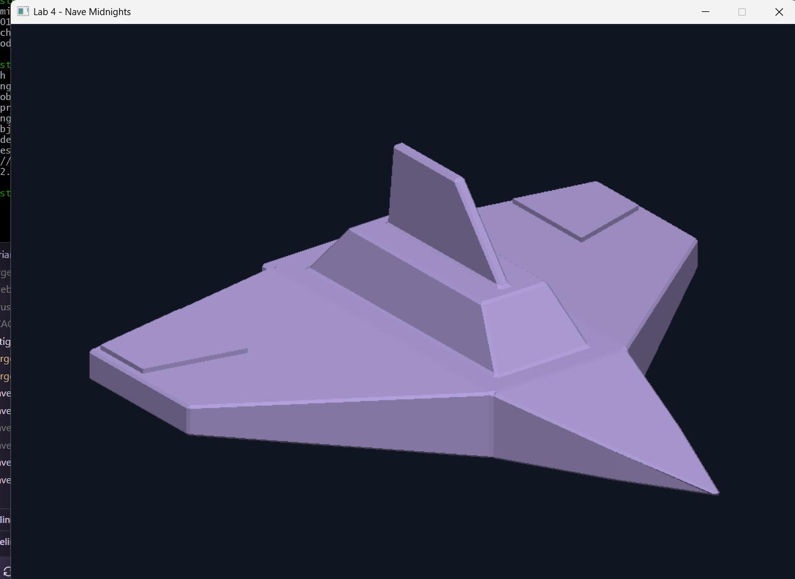

# Lab 4: Carga de modelos — Nave Midnights


Renderizador por software que carga la nave del laboratorio anterior desde un archivo OBJ y dibuja sus triángulos en una ventana. El modelo contiene **263 vértices y 522 triángulos**.

## Resultado



La nave se muestra centrada en un framebuffer de **1000 × 750 píxeles**, con margen para que el modelo completo quede dentro de la pantalla. Se utiliza una vista fija, un color base lavanda y una iluminación sencilla por cara para distinguir las superficies.

## Funcionamiento

1. El lector procesa las líneas `v` del OBJ para obtener las posiciones de los vértices y las líneas `f` para obtener los índices de las caras triangulares.
2. Los índices positivos del OBJ se convierten de base uno a base cero. También se admiten índices negativos y referencias como `v/vt/vn`.
3. Se aplican giros fijos y una proyección ortográfica. La escala y el desplazamiento se calculan a partir de los límites del modelo proyectado para centrarlo y conservar sus proporciones.
4. Se recorre manualmente cada cara y se buscan sus tres vértices por índice.
5. La función propia `triangle()` rellena cada triángulo mediante coordenadas baricéntricas. El buffer de profundidad decide qué superficie queda visible en cada píxel.
6. `minifb` abre la ventana y presenta el framebuffer calculado por el programa.

El recorrido de las caras en `src/renderer.rs` obtiene los índices y consulta los vértices así:

```rust
for face in &model.faces {
    let index_a = face[0];
    let index_b = face[1];
    let index_c = face[2];

    let a = model.vertices[index_a];
    let b = model.vertices[index_b];
    let c = model.vertices[index_c];

    // Se calcula el color de la cara con su normal y la luz.

    let screen_a = screen_vertices[index_a];
    let screen_b = screen_vertices[index_b];
    let screen_c = screen_vertices[index_c];

    // Se llama a triangle(buffer, screen_a, screen_b, screen_c, color).
}
```

El archivo `Nave_final.mtl` se conserva junto al modelo. Esta versión del renderizador utiliza un color base definido en el código y todavía no interpreta los materiales del MTL.

## Archivos principales

| Archivo | Función |
| --- | --- |
| `src/main.rs` | Carga el modelo, conecta el renderizador y mantiene la ventana abierta. |
| `src/obj_loader.rs` | Lee los vértices e índices del OBJ y valida las caras triangulares. |
| `src/framebuffer.rs` | Guarda los colores de los píxeles y sus profundidades. |
| `src/triangle.rs` | Rellena los triángulos píxel por píxel. |
| `src/renderer.rs` | Proyecta y centra el modelo, calcula la iluminación y recorre las caras. |
| `Nave_final.obj` | Nave exportada desde Blender con la malla triangulada. |
| `Nave_final.mtl` | Materiales asociados a la exportación de Blender. |
| `modelo.png` | Captura de la nave renderizada por el programa. |

## Ejecución

Se necesita Rust y Cargo instalados, junto con las herramientas de compilación de la plataforma. Desde la carpeta del repositorio, donde están `Cargo.toml` y `Nave_final.obj`, ejecutar:

```bash
cargo run
```

Para ejecutar con optimizaciones:

```bash
cargo run --release
```

La primera ejecución descarga y compila las dependencias. Presionar **Esc** o cerrar la ventana para terminar.

## Pruebas

```bash
cargo test
```

Las cuatro pruebas comprueban:

- Que el píxel más cercano prevalezca sin importar el orden de dibujo.
- Que limpiar el framebuffer reinicie el color y la profundidad.
- Que invertir el orden de los vértices produzca el mismo triángulo relleno.
- Que un triángulo sin área no pinte píxeles.
